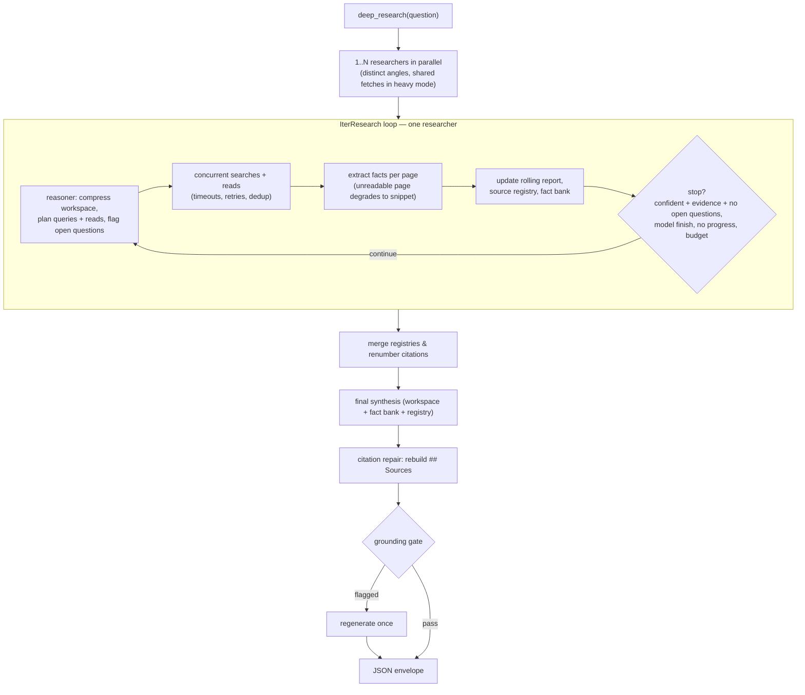

# Deep Research

[](LICENSE)
[](https://github.com/mindroom-ai/deep-research-plugin/actions/workflows/plugin-ci.yml)
[](https://docs.mindroom.chat/plugins/)
[](https://docs.mindroom.chat/tools/)

<picture>
  <source media="(prefers-reduced-motion: no-preference)" srcset="https://raw.githubusercontent.com/mindroom-ai/mindroom/main/assets/logo/logo-mark-animated.svg" />
  
</picture>

A [MindRoom](https://github.com/mindroom-ai/mindroom) tool plugin that runs a bounded, multi-round web research loop and returns a cited Markdown report, powered by the calling agent's own model.

Ask one hard question and `deep_research` searches, reads primary sources, compresses findings between rounds so long runs stay inside context, and runs a best-effort grounding check on cited claims before answering (it can be disabled via `grounding=False`, skipped near the deadline, or fail while still returning a report—check `warnings`).

> **Prompt:** Compare HTTP/3 adoption and fallback latency across Cloudflare, Fastly, and AWS CloudFront.
>
> **Streamed progress:** `round 3/100 · 0.65 · 1 open · Reading primary docs to verify UDP fallback timing`
>
> **Report excerpt:** CloudFront documents 0-RTT handshake reductions on repeat connections [1], while Fastly details Happy Eyeballs fallback when UDP is blocked [2].

- **Runs on your agent's model:** provider-agnostic, with optional `extract_model` (cheaper extraction) and `ground_model` (independent verification) overrides.
- **Long-horizon without context blow-up:** compresses its rolling report between rounds while preserving extracted facts in an append-only fact bank and verified `[n]` source registry.
- **Heavy mode (`parallel_researchers`):** runs up to 4 concurrent loops on distinct angles with shared page fetches and extractions, then merges them into one synthesis.
- **Fail-soft by design:** skips duplicate queries/URLs, degrades unreadable pages to labeled snippet sources, checks cited claims via a grounding gate, and reserves wall-clock time for synthesis.
- **Pluggable search:** uses MindRoom's built-in Serper tool and native `website` reader by default, with optional custom backends and extra internal `search_channels`.

## Quick start

```bash
mindroom plugins install deep-research-plugin
```

Make sure Serper has an API key configured (or override `search_tool` below), then enable the plugin and attach `deep_research` to an agent in `config.yaml`:

```yaml
plugins:
  - path: plugins/deep-research-plugin

agents:
  researcher:
    tools:
      - deep_research
```

Update later with `mindroom plugins update deep-research-plugin`.
Needs MindRoom v2026.10.715 or later.
No extra Python dependencies or external research services are required.

## Tools

The plugin registers the `deep_research` toolkit exposing one agent tool:

| Tool | Purpose |
|------|---------|
| `deep_research(question, ...)` | Run a bounded, multi-round research loop for one question and return a JSON envelope with a cited Markdown report, verified sources, confidence, stats, and warnings. |

## Settings

Configure optional settings on the agent's `deep_research` entry in `config.yaml` (or globally on the tool):

| Setting | Default | Description |
|---------|---------|-------------|
| `search_tool` | `serper` | Registered MindRoom tool (built-in or plugin) used for web search. |
| `search_function` | `""` | Single function on `search_tool` used for every query kind. Leave empty for Serper's `serper_search` (`web`/`news`/`scholar`) or legacy `search_web` / `search_news` / `search_scholar` routing. |
| `search_channels` | `[]` | Extra named search backends (`web`, `news`, `scholar` are reserved) the reasoner queries by `kind`. Use JSON object strings in per-agent config. |

<details>
<summary><b>Tool parameters and output envelope</b></summary>

| Parameter | Default | Bounds & behavior |
|-----------|---------|-------------------|
| `question` | required | Non-empty research question. |
| `max_rounds` | `100` | Clamped `1`–`100`. Soft cap on reasoning rounds. |
| `wall_clock_seconds` | `9000` | Clamped `60`–`9000` (150 min). Hard deadline; search rounds stop early to reserve time for synthesis. |
| `model` | `None` | Model alias from `models:`; defaults to the calling agent's active model. |
| `verbosity` | `"progress"` | `"progress"` streams per-round status lines; `"verbose"` adds planned queries and read URLs; `"silent"` returns only the final report. |
| `max_queries_per_round` | `5` | Clamped `1`–`10`. Maximum planned search queries per round. |
| `results_per_query` | `10` | Clamped `1`–`30`. Candidate hits requested per query. |
| `max_reads_per_round` | `10` | Clamped `1`–`20`. Maximum URLs read per round. |
| `page_char_limit` | `150000` | Clamped `10000`–`600000`. Maximum page characters passed to extraction. |
| `report_token_cap` | `16000` | Clamped `2000`–`64000`. Approximate rolling-report budget (`~4` chars/token). |
| `parallel_researchers` | `1` | Clamped `1`–`4`. Heavy mode: concurrent loops on distinct angles merged into one synthesis (roughly multiplies token cost). |
| `extract_model` | `None` | Optional model alias for page extraction; defaults to the run's main model. |
| `grounding` | `True` | Set `False` to skip the final grounding gate and save one or two LLM calls. |
| `ground_model` | `None` | Optional model alias for grounding checks to decorrelate verification from writing; defaults to the run's main model. |

**Output envelope:**

- **Success (`status: "ok"`):** `status`, `tool` (`"deep_research"`), `question`, `report` (cited Markdown with `[n]` references and rebuilt `## Sources`), `sources`, `sources_considered`, `sources_used`, `confidence`, `rounds_used`, `stopped_reason`, `elapsed_seconds`, `warnings`, and `stats`.
- **`stopped_reason`:** `confident`, `model_finished`, `no_progress`, `max_rounds`, `wall_clock`, or `synthesis_truncated` (in single-researcher runs, only `synthesis_truncated` means final synthesis was cut short; in heavy mode, `synthesis_truncated` can also come from a researcher—when every surviving researcher stops with it—even when final synthesis finishes).
- **`stats`:** counts of `searches`, `search_attempts`, `search_failures`, `reads`, `read_attempts`, `read_failures`, `extractions`, `duplicate_queries_skipped`, `duplicate_reads_skipped`, `read_snippet_fallbacks`, `snippet_sources_registered`, `grounding_issues`, `grounding_regenerations`, and `finished_with_open_questions` (plus `cross_researcher_reads_shared` and `cross_researcher_extracts_shared` in heavy mode).
- **Error (`status: "error"`):** `status`, `tool`, `message`, and `warnings` (also returned when every search fails and no source is found).

</details>

<details>
<summary><b>How it works</b></summary>



1. **Plan & act:** Each round sends one tool-less structured prompt to the active model, then executes planned searches and page reads concurrently (bounded concurrency, per-operation timeouts, retries). Duplicate queries/URLs are skipped, and transient reasoner failures skip a round rather than aborting.
2. **Extract & compress:** Extracted facts enter an append-only fact bank while the rolling report compresses in place within `report_token_cap`. Unreadable pages degrade to labeled snippet sources, and the reasoner can cite snippet hits directly via `cite_snippet_urls`.
3. **Stop conditions:** Stops on evidence-gated confidence (`>= 0.8` with registered sources and no open questions), model finish, consecutive no-progress rounds, or round/wall-clock caps (reserving time for synthesis). Unresolved open questions surface explicitly in the report.
4. **Synthesize & ground:** Heavy mode merges registries and renumbers citations before final synthesis. Citation repair rebuilds `## Sources` from cited entries only, and the fail-soft grounding gate verifies cited claims and regenerates at most once if flagged (skipping near the deadline and discarding regenerations that lose citations).

</details>

<details>
<summary><b>Custom search backends and extra channels</b></summary>

Any registered MindRoom tool can replace Serper or serve as an extra named channel (e.g., an internal wiki, document index, or chat search). Because MindRoom validates per-agent `string[]` overrides as lists of strings, author structured `search_channels` entries as JSON object strings on an agent's tool entry:

```yaml
agents:
  researcher:
    tools:
      - deep_research:
          search_tool: my_search      # default: serper
          search_function: search     # omit for Serper's web/news/scholar routing
          search_channels:
            - '{"name": "wiki", "description": "Internal documentation and runbooks", "tool": "my_wiki_tool", "function": "search_documents"}'
            - '{"name": "chat", "description": "Team chat history", "tool": "mcp_chat", "function": "chat_call_tool", "arguments": {"tool_name": "search_messages", "arguments": {"query": "{query}", "limit": "{num_results}"}}}'
```

- **Other entry formats:** Plain YAML mappings work in global tool config; compact strings (`"wiki=my_wiki_tool.search_documents|Internal docs"`) work when no `arguments` template is needed.
- **Inherited settings & OAuth:** Search and channel tools inherit the agent's authored overrides for those tools except function-hiding switches (`enable_*`/`all: false`, `include_tools`, `exclude_tools`). Extra channels also inherit the agent's worker target so OAuth-backed MCP tools run with the requester's session.
- **Fallback behavior:** A missing `web` function on `search_tool` fails immediately; missing `news`/`scholar` functions or unavailable channels drop with a warning. `web`, `news`, and `scholar` are reserved names, and unknown kinds fall back to `web`.
- **Call contract:** Without `arguments`, functions are called as `fn(query)` (plus `num_results` if accepted). With `arguments`, `{query}` and `{num_results}` are substituted—exact placeholders preserve type (`"{num_results}"` becomes an integer). Async functions and MCP result objects (`ToolResult`/`ToolValue`) are supported.
- **Result JSON shapes:** Custom search functions must return a **JSON-encoded string** (or an MCP `ToolResult`/`ToolValue` whose content is a JSON-encoded string), not a raw Python `list`/`dict`. The JSON string must parse to a top-level list or an object with `organic`/`news`/`articles`/`scholar`/`results`/`sources`/`items`/`documents` rows carrying URL (`link`/`url`/`uri`/`permalink`), title, and snippet fields. Payloads with `error` or `status: "error"` count as failures; internal URLs the `website` reader cannot fetch degrade to snippet sources.

</details>

<details>
<summary><b>Prior art</b></summary>

Adapts ideas from two open research systems onto MindRoom's existing models and tools — no dedicated research models, GPUs, or extra services:

- [Tongyi DeepResearch](https://github.com/Alibaba-NLP/DeepResearch) (Alibaba) — IterResearch round loop (plan → act → compress), round/wall-clock budgets, and heavy mode's Research-Synthesis pattern.
- [Lunon Deep Research](https://github.com/LunonAI/lunon-deep-research) (Lunon) — fail-soft degradation at every step, grounding gate with single regeneration, evidence-gated stopping, snippet fallbacks, and role-based model routing.

</details>
